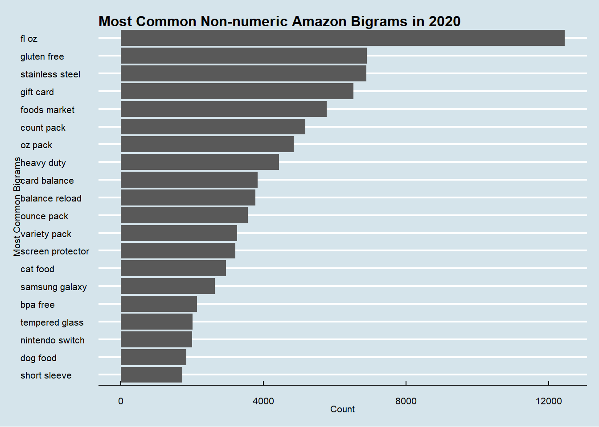
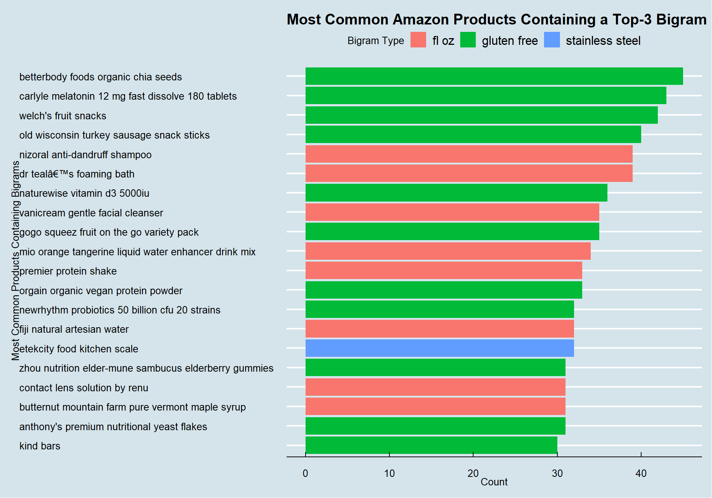
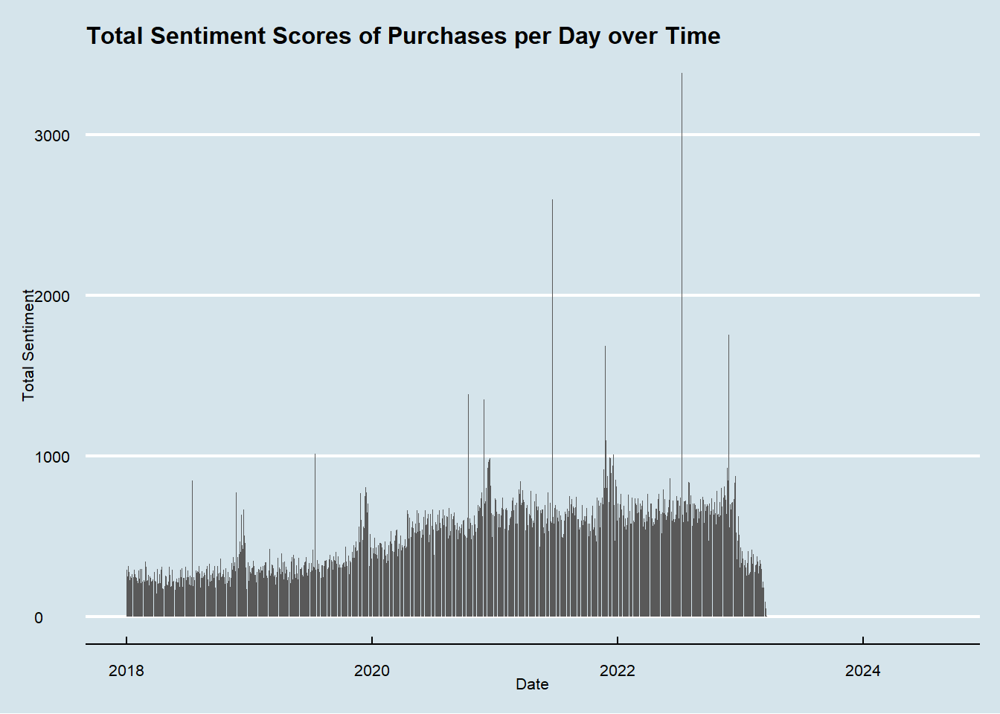
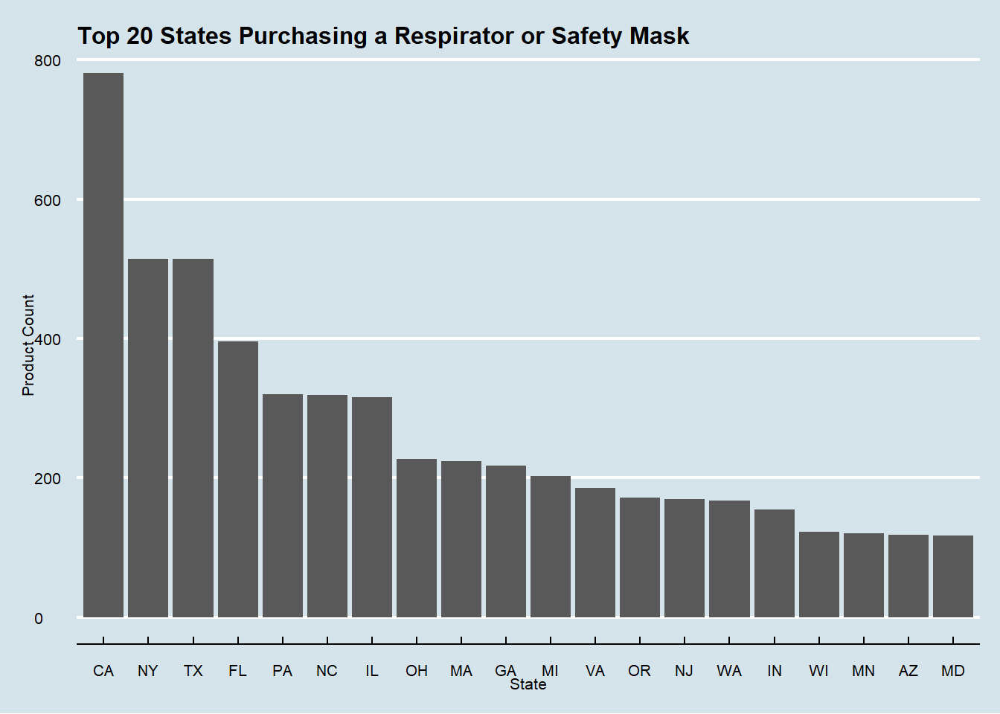
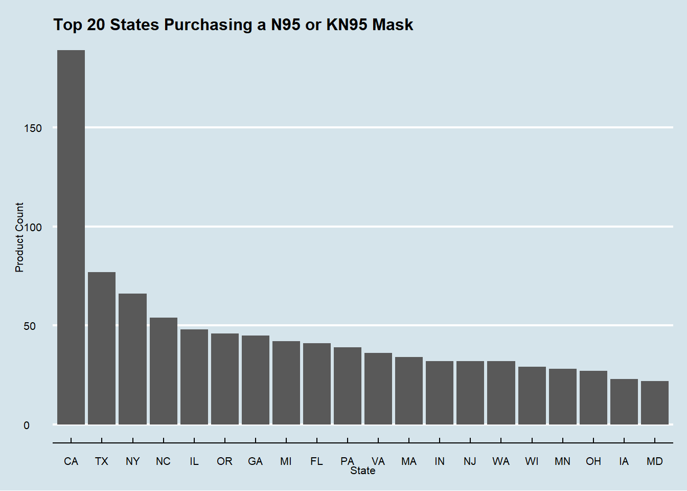
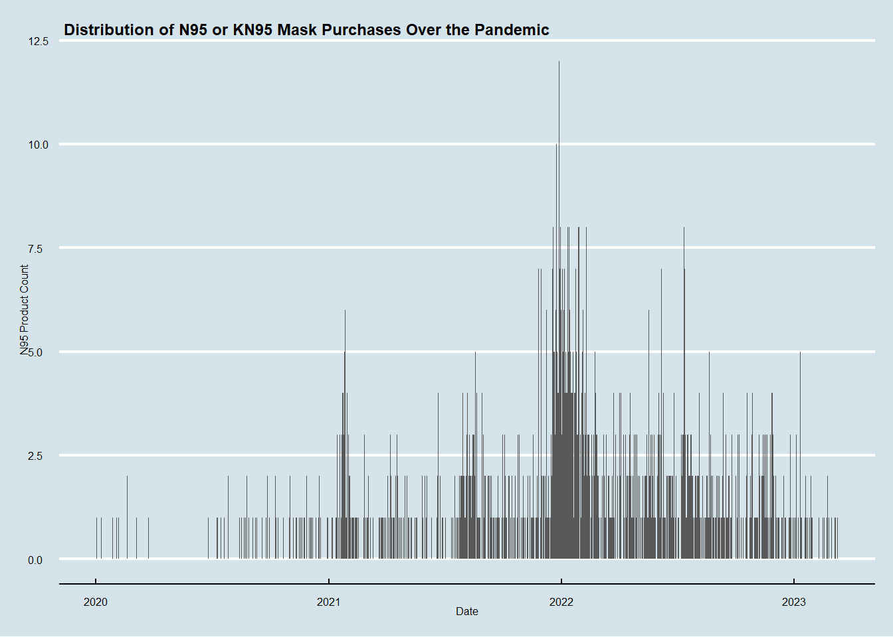

Code: https://github.com/floydhen1-prog/SDS_264_part2/blob/main/Mini%20Project%201/Mini_Project_1_Floyd.qmd


## Introduction

In the digital age, shopping has moved in mass to digital marketplaces. Amazon holds a tight fist on this economy, but with massive sales comes massive user interaction. Because of the sheer volume of products purchased by consumers, analyzing Amazon purchases can reveal insight into the United States' spending preferences and habits, from the most common products and word pairings to historical COVID patterns.

Our dataset comes from Harvard Dataverse, as an online survey spanning 5 years from 5027 users. Each obseration represents the exact product purchased, as well as several descriptive variables.

In this project, we will examine how common non-numeric bigrams are present in products, explore the sentiment patterns of words in products, and extrapolate mask purchasing patterns into larger COVID-19 contexts.


## Data

Our dataset, `amazon_purchases`, contains 1,757,055 products from 2018 to the end of 2022. There are 6 columns, including the product `Title`, `Category` of product, `Quantity` purchased, `Price`, `State` shipping address, and `Date` purchased. To initially clean our dataset, we must convert column names to more simplistic title, and filter out product categories conducive to explicit titles. We also note that the dataset may be too large to unnest for operations such as bigrams (although sentiment analysis performs adequately), so the year 2020 was chosen as a subset for these operations, `amazon_2020`.

Now that our data is tidy, what can we learn about commonly purchased items? What is the most common item (besides digital codes like gift cards)?


::: {.cell}
::: {.cell-output .cell-output-stdout}

```
                                                         Title   n
1 amazon basics 48 pack aa high-performance alkaline batteries 573
```


:::
:::


This product, a 48-pack of AA batteries, is the most commonly purchased non-gift card item on Amazon during the entire time period. We can use str_detect() and str_remove() to filter out gift card products and shorten the title to a readable length.


## Bigrams

What about bigrams, however? Through unnesting our `amazon_2020` dataset and sorting them without stopwords, and filtering any digits with str_detect(), we can sort them into the most common pairs. We are also removing the word "amazon" from the bigrams, to avoid brands such as "Amazon Basics".


::: {.cell}
::: {.cell-output-display}
{width=672}
:::
:::


The three most common non-numeric bigrams in 2020 were "fl oz", "gluten free", and "stainless steel", reflecting common purchases for drinks, allergen-friendly food, and tools/ instruments. This isn't very helpful for learning what specific products use these pairings, though. To examine the most common product titles that use these top 3 bigrams, we must str_detect() to pull products with any of the three. However, the titles are often too long to work with. In order to shorten the titles while retaining the bigram (in case the bigram is at the end of the string), we must create a new column that provides each row's bigram before shortening the title. By creating 3 logical categories for each bigram per product and pivot_longer(), we can create a single `type` column.


::: {.cell}

:::


We can now neatly plot the 20 most common bigram products in 2020, now that the only the first phrase of the title remains with the bigram as a character variable.


::: {.cell}
::: {.cell-output-display}
{width=960}
:::
:::


This plot is a bar chart highlighting the most common Amazon purchases in 2020 that include the phrase "fl oz", "gluten free", or "stainless steel". The y axis represents the 20 most common products and is color coded by the phrase present, while the x axis counts the number of products purchased in 2020, ranging from 0 to 45. This plot shows us the most popular items with these phrases, such as chia seeds and melatonin, and the prevalence of each word combo against each other. There are 11 gluten free items, 8 items measured in fl oz, and 1 stainless steel item.

We can see that even though "fl oz" is the more common bigram, specific products containing "gluten free" in their title are more prevalent. In other words, the prevalence of "fl oz" is spread out among less popular items. Chia seeds were the most popular item, and only one stainless steel item was included, a kitchen scale.

## Sentiment Scores

What about identifying words with a positive/ negative connotation? After unnesting the entire `amazon_purchases` dataset, we can join each word to its associated sentiment, and determine whether the connotations of purchase words change over time. We can mutate a new column that finds the difference in positive and negative sentiments per day, to also determine if one connotation is stronger.


::: {.cell}
::: {.cell-output-display}
{width=672}
:::
:::


The total sentiment score is entirely positive for this dataset, as the positive words outweight the negative words every day. There seems to be a slight increase in total sentiment score over time, with a few days having very high scores.


::: {.cell}
::: {.cell-output .cell-output-stdout}

```
# A tibble: 1 × 3
  Date       negative positive
  <date>        <int>    <int>
1 2022-07-12     1591     4975
```


:::
:::


By peeling off only the day with the most amount of negative words, we can see that the negative sentiment fails to outnumber the positive sentiment. This makes sense, as some popular positive words include "soft", "support", "easy", and any words that might describe the product as positive to the customer. Popular negative words include "pain", "odor", "cold", or any other products that may be used as theraputic or described with traditionally negative words. This plot demonstrates that positive words vastly outnumber negative words in product descriptions, as companies attempt to advertise their product.

## COVID-19 Mask Purchase Patterns

Examining word associations is great, but what about products reflecting real-world events? Utilizing `Date` and `State`, we can learn political and historical patterns through this purchase data. For example, we can compare which states bought the most face masks during the entirety of the dataset period. These are broadly classified in Amazon as a "respirator" or "face mask", and encompass a wide variety of products.


::: {.cell}
::: {.cell-output-display}
{width=672}
:::
:::


California dominates the other states in purchasing face masks, followed by New York, Texas, and Florida. This is in line with state population size. However, I became suspiscious of these purchases as I continued my analysis. Because little regulation exists around mask sales, I realized many products counted as a mask that did not necessarily correlate to safety from COVID-19, and I was especially suspicious of Florida and Texas having such high mask purchase rates, being politically red states opposed to mask mandates. Here is an example of a mask product that may not contribute to COVID-19 safety in Texas, for example:


::: {.cell}
::: {.cell-output .cell-output-stdout}

```
  Quantity
1        1
                                                                                                                   Title
1 this facemask is as useless as joe biden anti-dust black mouth_mask unisex cotton face bandanna anime for cycling camp
     Category State Price       Date
1 safety_mask    TX 12.99 2020-12-10
```


:::
:::


Instead of filtering out an impossible number of ineffective/ joke masks, I instead used str_detect() to find purchases of N95s or KN95s, one of the most protective and recommended consumer masks by public health officials. The distribution of states changes when only considering highly effective masks.


::: {.cell}
::: {.cell-output-display}
{width=672}
:::
:::


From this purchase history alone, we can see that California residents took masking the most seriously, while Texas and Florida proportionally shrank their amount of masks purchased in relation to California. Florida even shrank to the 9th most N95 masks purchased, even though it is the 3rd most populated state.

We can also use the N95 or KN95 purchase history to map the intensity of the pandemic, using str_detect() to peel off dates beginning in 2020.


::: {.cell}
::: {.cell-output-display}
{width=672}
:::
:::


While not confirmed without other COVID data, we can estimate that the most severe outbreaks during the pandemic occurred in late 2021/ early 2022, based on the amount of highly protective N95 masks purchased. There is also a noticeably dense spike during early 2021.

## Conclusion

We have seen that even mundane data such as Amazon products can reveal greater patterns around U.S. populations. We determined that Amazon users highly prioritize specific gluten free items and liquids measured in fl oz, and that product words tend to be positive as to attract consumers. We saw that large states like California, Texas, and Florida bought a large amount of masks, but that California customers valued ultra-protective masks like N95s proportionally more. COVID-19 spread patterns could even be observed through this data, as spikes in N95 mask purchases reflected mask mandates and case fluctuations. Data is never neutral, and peeling consumer patterns out of purchase histories demonstrates how stories hide under every point.

Berke, Alex, Dan Calacci, Robert Mahari, Takahiro Yabe, Kent Larson, and Sandy Pentland. 2023. “Open E-Commerce 1.0: Five Years of Crowdsourced U.S. Amazon Purchase Histories with User Demographics.” Harvard Dataverse. https://doi.org/10.7910/DVN/YGLYDY.

